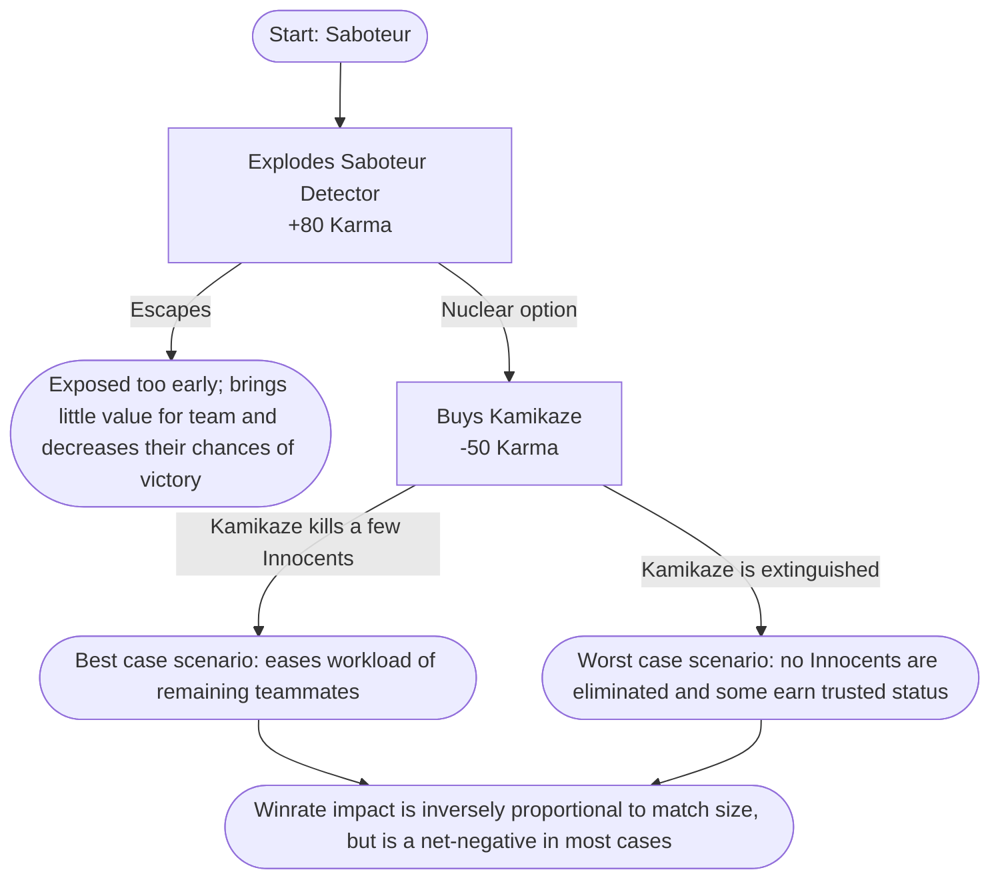

## The problems we wish to solve

**If teamwork is not compensated, most players will act selfishly**. This manifests in many ways:

- Shop items can be bought to no benefit for user or might only be used selfishly rather than for the team
  - Explosive extinguishers are only used for themselves rather than saving other trusted Innocents, Detectives or the Saboteur Detector
  - Secret Fireworks makes Innocents able to give information on their corpse's whereabouts, but don't reward them for it and prevents them from buying other important items
  - Trap removers allow Detectives to ensure Innocents won't die to them, but might lead them to be short on Karma for more important purchases, like the Portable Detector Recharge
- Saboteurs can farm Karma by **Detector Scumming**. There's a surplus in exploding the Detector, buying a Kamikaze and killing some players with it
  - It puts the remaining Saboteurs at a disadvantage in most cases
  - Killed players may feel wronged by what many consider "a cheap tactic"
  - Makes matches staler when Kamikazes become expected and Extinguishers are bought preemptively by some, killing player expression in item purchases

## Solution: Gratitude

Gratitude acts as a pending Karma balance; it rewards players for good team behavior while also patching out bad behavior. Gratitude can be earned by many means, including:

- **(Non-saboteur only)** Saving a Detector or Detective from another player's TNT using an Extinguisher
- **(Innocent only)** Activation of Secret Fireworks
  - Now a surplus rather than just a waste of Karma
- **(Saboteur only)** Destroying a Detector
  - Replaces the previous Karma reward, patching Detector Scumming
  - Kamikazes can actually surprise players now as they become far more situational
- **(Detective only)** Successfully using a Trap Remover
  - Refunds Trap Remover's costs in Karma and gives a small bonus in Gratitude
  - This ensures Detectives aren't discouraged from buying them if it might prevent them from buying Portable Detector Recharges later on
- **(Detective only)** Detectives earn Gratitude instead of Karma when [reporting corpses](/blog/sabotage-game-balance-corpse-reporting)
  - Fixes a balancing issue introduced with corpse reporting where Detectives could buy multiple Portable Detector Recharges with little to no risks compared to they would usually do for Karma, such as participating in testing or killing Saboteurs

Once the match is over, earned Gratitude is converted into Karma and factored in for the Best Players score.

Lifetime Gratitude is accounted for and alternate Lobby chat prefix Emblems are unlocked at major milestones. Nothing like vanity to encourage players to be good sports!

## Results

We analyzed the server's data for the two weeks before and after Gratitude was implemented. Here's some interesting data:

### Item purchases

- Kamikaze purchases plummeted **(56 v.s. 14)**
  - Direct impact of patching Detector Scumming, Saboteurs are required to kill at least 2 Innocents or a Detective prior to buying a Kamikaze
- Fire extinguisher purchases stagnated **(105 v.s. 113)**
  - They don't have to be purchased as much to counter Kamikazes, but players still want them to protect Detectives and the Sabotage Detector from trapped chests.
- Secret fireworks purchases skyrocketed **(4 v.s. 246)**
  - Innocents now often buy them in scenarios of certain death to guarantee some Karma

### Winrate impact

item purchases increased
matches with at least one detective alive increased
matches where at least
saboteur winrate increased in matches with 3+ sabs, decreased in matches with 2 or 1 sabs

